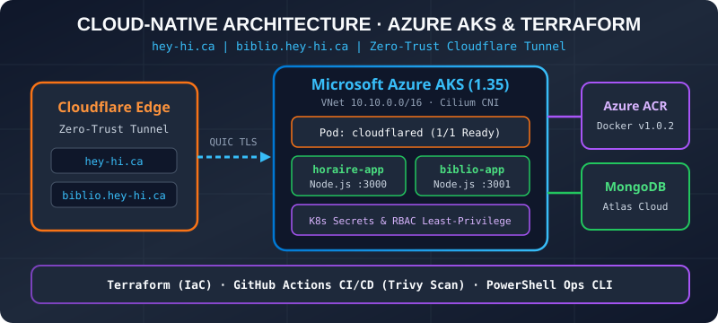

# Cloud-Native Migration to Azure AKS with Terraform & Cloudflare Zero-Trust (`hey-hi.ca`)

[Français](README.md) | **English**

> **Hands-on DevOps Engineering Project — DevOps Specialist Preparation (Devolutions)**  
> **Author:** Vincent Lortie (`@Dunedude84`)  
> **Live Production Applications:** [https://hey-hi.ca](https://hey-hi.ca) & [https://biblio.hey-hi.ca](https://biblio.hey-hi.ca)

---

## 1. Project Context & Objective

I own and maintain a personal web platform consisting of two Node.js/Express applications backed by **MongoDB Atlas**:
1. **`hey-hi.ca` (`horaire-app`)**: Employee shift scheduling and management web application (automated shift assignment algorithm, employee portal, and read-only guest demo mode).
2. **`biblio.hey-hi.ca` (`biblio-app`)**: Personal library manager integrated with the OpenLibrary REST API.

Originally hosted on a local home server (supervised by **PM2**) behind a Cloudflare Tunnel, I used AI tools (LLMs) as an interactive learning mentor to **containerize and migrate the entire platform to Microsoft Azure Kubernetes Service (AKS)** provisioned via **Terraform**, while building automated **GitHub Actions CI/CD** pipelines and **PowerShell / Bash / Python** operational tooling.

---

## 2. Cloud Architecture & Zero-Trust Security

<p align="center">
  
</p>

### Architecture Highlights:
- **100% Zero-Trust Exposure (In-Cluster Cloudflare Tunnel)**: No public Azure LoadBalancer or inbound ports are opened on the Network Security Group (`NSG`). The `cloudflared` Pod establishes an encrypted outbound connection (post-quantum QUIC) to Cloudflare Edge and routes traffic to internal `ClusterIP` Services (`http://horaire-service.hey-hi.svc.cluster.local:80` and `http://biblio-service.hey-hi.svc.cluster.local:80`).
- **Secretless Authentication between AKS and ACR**: The Azure Container Registry admin account is disabled (`admin_enabled = false`). AKS Kubelet pulls container images via an Azure RBAC role assignment (`AcrPull`) bound to its Managed Identity.
- **Principle of Least Privilege (Kubernetes RBAC & Microsoft Entra ID)**: Azure AD RBAC integration is enabled alongside scoped Kubernetes `ServiceAccount` / `Role` / `RoleBinding` manifests (`k8s/hey-hi/rbac-readonly.yaml`) that allow read-only Pod/Log inspection while strictly blocking `Secret` access or Pod deletion.

---

## 3. Repository Structure

```text
.
├── .github/workflows/
│   └── ci-cd.yml                 # GitHub Actions CI/CD Pipeline (Node.js Unit Tests, Terraform Validate, Trivy Scan, AKS Deploy)
├── terraform/                    # Infrastructure as Code (Terraform azurerm v4)
│   ├── providers.tf              # AzureRM Provider configuration
│   ├── variables.tf              # Input variables (canadacentral, Kubernetes 1.35, Standard_D2as_v7)
│   ├── network.tf                # VNet, AKS Subnet, and Network Security Group
│   ├── aks.tf                    # AKS Cluster (Azure CNI Overlay + Cilium, OIDC, Entra ID RBAC, Autoscaler)
│   ├── acr.tf                    # Azure Container Registry + AcrPull Role Assignment
│   └── outputs.tf                # Terraform Outputs
├── k8s/
│   ├── hey-hi/                   # Production Kubernetes Manifests (hey-hi.ca & biblio.hey-hi.ca)
│   │   ├── deployments.yaml      # Deployments & ClusterIP Services (Liveness/Readiness Probes, CPU/RAM Limits)
│   │   ├── cloudflared.yaml      # In-cluster Cloudflare Tunnel connector Deployment
│   │   ├── rbac-readonly.yaml    # Read-only RBAC Role & RoleBinding (Least Privilege)
│   │   └── kustomization.yaml    # Kustomize entrypoint
│   └── base/                     # Initial learning lab (Go + PostgreSQL StatefulSet + Cilium NetworkPolicy)
├── scripts/                      # Internal DevOps Operational Tooling
│   ├── hey-hi-ops.ps1            # PowerShell Ops CLI (status, logs, deploy, rollback, test-urls, restart, metrics)
│   ├── hey-hi-ops.sh             # Bash equivalent (set -euo pipefail)
│   └── hey-hi-ops.py             # Python script for Pod JSON inspection & HTTP healthchecks
├── hey-hi/                       # Source code for both Web Applications (Node.js / Express)
│   ├── Dockerfile                # Hardened Docker image (node:22-alpine, non-root USER node) for hey-hi.ca
│   ├── server.js                 # Primary Express server (Schedule Manager)
│   └── api_biblio/book-api/
│       ├── Dockerfile            # Hardened Docker image for biblio.hey-hi.ca
│       └── index.js              # Secondary Express server (Personal Library)
└── docker-compose.yml            # Local multi-container development environment
```

---

## 4. Internal DevOps Operations CLI (`scripts/hey-hi-ops.ps1`)

To reduce developer friction and standardize operational workflows (deployments, monitoring, and *on-call* incident response), I built a PowerShell CLI utility featuring strict parameter validation (`[ValidateSet]`):

```powershell
# Check Pod and Service status in the Azure AKS cluster
.\scripts\hey-hi-ops.ps1 -Command status

# Inspect real-time CPU and RAM usage (metrics-server)
.\scripts\hey-hi-ops.ps1 -Command metrics

# Run synthetic HTTPS availability checks through Cloudflare Tunnel
.\scripts\hey-hi-ops.ps1 -Command test-urls

# Tail logs across both web apps and the Cloudflare Tunnel connector
.\scripts\hey-hi-ops.ps1 -Command logs

# Perform a zero-downtime Rolling Restart
.\scripts\hey-hi-ops.ps1 -Command restart

# Build, push to ACR, and roll out a new version to AKS
.\scripts\hey-hi-ops.ps1 -Command deploy -Version v1.0.2

# Perform an idempotent declarative rollback (resync cluster with deployments.yaml)
.\scripts\hey-hi-ops.ps1 -Command rollback
```

---

## 5. Engineering Log: Real-World Challenges Resolved During Migration

1. **Azure Resource Provider Registration (`azurerm` v4)**:
   - *Issue*: On a fresh Azure subscription, Terraform hung while attempting to auto-register unrelated providers (such as `Microsoft.AVS`).
   - *Fix*: Configured `resource_provider_registrations = "none"` after verifying via `az provider list` that `Microsoft.ContainerService`, `Microsoft.ContainerRegistry`, and `Microsoft.Network` were already `Registered`.
2. **Regional Kubernetes Versions & VM SKU Quotas in `canadacentral`**:
   - *Issue*: Version `1.30` and `Standard_B2s` were no longer available for new AKS deployments in `canadacentral`.
   - *Fix*: Queried supported versions via `az aks get-versions --location canadacentral` and upgraded to Kubernetes `1.35` on `Standard_D2as_v7` nodes, adding `lifecycle { ignore_changes = [default_node_pool[0].node_count] }` to prevent Terraform from overwriting autoscaler decisions.
3. **Application Auth Fix & Zero-Downtime Rolling Updates (`v1.0.0` $\rightarrow$ `v1.0.2`)**:
   - *Issue*: Logging out of `biblio.hey-hi.ca` initially redirected to `localhost:3000`, and static middleware ordering allowed unauthenticated access to the root page shell.
   - *Fix*: Added dynamic `hostname` resolution and placed `express.static` behind the authentication middleware, then built and rolled out `v1.0.2` via ACR and AKS *Rolling Update* with `readinessProbe` verification and zero downtime.
4. **On-Call Incident Simulation (`ImagePullBackOff`) & Idempotent Rollback**:
   - Simulated a broken deployment (`v9.9.9-broken`), diagnosed the root cause using `kubectl describe pod` (`Events` log inspection), and implemented a declarative rollback (`kubectl apply -f ./k8s/hey-hi/deployments.yaml`) ensuring idempotence and eliminating configuration drift warnings.
5. **Transitioning from Local PM2 to Native Kubernetes Orchestration**:
   - *Context*: On my home server, **PM2** handled Node.js process supervision (`pm2 start`), log aggregation (`pm2 logs`), and resource monitoring (`pm2 monit`).
   - *Cloud-Native Design*: Inside the `Dockerfile`s, applications run directly as PID 1 (`CMD ["node", "server.js"]`) without an intermediate PM2 daemon, delegating process supervision, self-healing, and rolling restarts natively to **Kubernetes** (`ReplicaSets`, `livenessProbe` / `readinessProbe`, and `hey-hi-ops.ps1`).
