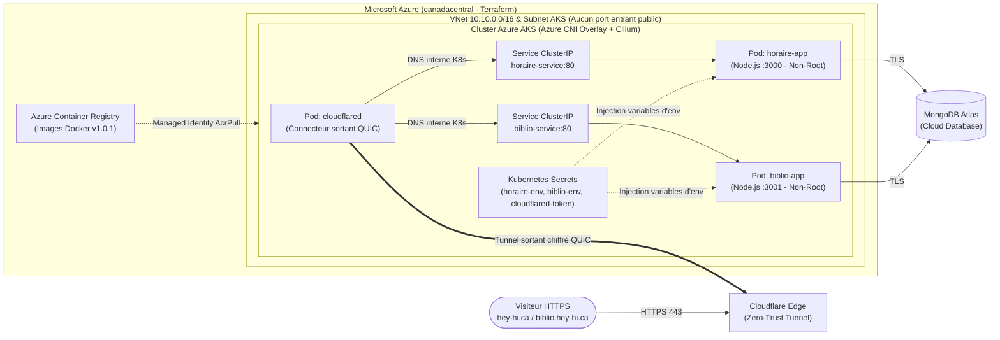

# Migration Cloud-Native vers Azure AKS avec Terraform & Cloudflare Zero-Trust (`hey-hi.ca`)

> **Projet de préparation pratique — Poste de Spécialiste DevOps (Devolutions)**  
> **Auteur :** Vincent Lortie (`@Dunedude84`)  
> **Applications en production :** [https://hey-hi.ca](https://hey-hi.ca) & [https://biblio.hey-hi.ca](https://biblio.hey-hi.ca)

---

## 1. Contexte & Objectif du Projet

Je possède et maintiens une plateforme web personnelle composée de deux applications Node.js/Express connectées à **MongoDB Atlas** :
1. **`hey-hi.ca` (`horaire-app`)** : Application de planification et gestion d'horaires d'employés (avec algorithme d'attribution de quarts, portail employé et mode démonstration invité).
2. **`biblio.hey-hi.ca` (`biblio-app`)** : Gestionnaire de bibliothèque personnelle connecté à l'API OpenLibrary.

Initialement hébergées sur un serveur local à domicile derrière un tunnel Cloudflare, j'ai entrepris — en utilisant mes outils d'IA (LLM) comme mentor interactif — de **conteneuriser et migrer l'intégralité de cette plateforme vers Microsoft Azure Kubernetes Service (AKS)** géré par **Terraform**, tout en construisant les outils d'automatisation CI/CD et d'opérations associés.

---

## 2. Architecture Infonuagique & Sécurité Zero-Trust



### Points forts de l'architecture :
- **Exposition 100 % Zero-Trust (Cloudflare Tunnel dans Kubernetes)** : Aucun LoadBalancer public Azure ni port entrant n'est ouvert sur le Network Security Group (`NSG`). Le Pod `cloudflared` établit une connexion sortante chiffrée (QUIC post-quantique) vers Cloudflare et route le trafic vers les Services `ClusterIP` internes (`http://horaire-service.hey-hi.svc.cluster.local:80` et `http://biblio-service.hey-hi.svc.cluster.local:80`).
- **Authentification sans secret statique entre AKS et ACR** : Le compte administrateur d'Azure Container Registry est désactivé (`admin_enabled = false`). Le Kubelet d'AKS tire les images via une attribution de rôle RBAC Azure (`AcrPull`) sur son identité managée.
- **Moindre Privilège (RBAC Kubernetes & Microsoft Entra ID)** : Intégration RBAC Azure AD activée et profils `ServiceAccount` / `Role` / `RoleBinding` restreints (`k8s/hey-hi/rbac-readonly.yaml`) interdisant la lecture des `Secrets` ou la suppression de Pods aux comptes d'observation.

---

## 3. Structure du Dépôt

```text
.
├── .github/workflows/
│   └── ci-cd.yml                 # Pipeline CI/CD GitHub Actions (Tests Node.js, Terraform Validate, Scan Trivy, Déploiement AKS)
├── terraform/                    # Infrastructure as Code (Terraform azurerm v4)
│   ├── providers.tf              # Configuration Provider AzureRM
│   ├── variables.tf              # Variables (canadacentral, Kubernetes 1.35, Standard_D2as_v7)
│   ├── network.tf                # VNet, Subnet AKS et Network Security Group
│   ├── aks.tf                    # Cluster AKS (Azure CNI Overlay + Cilium, OIDC, RBAC Entra ID, Autoscaler)
│   ├── acr.tf                    # Azure Container Registry + Role Assignment AcrPull
│   └── outputs.tf                # Sorties Terraform
├── k8s/
│   ├── hey-hi/                   # Manifestes Kubernetes de production (hey-hi.ca & biblio.hey-hi.ca)
│   │   ├── deployments.yaml      # Deployments & Services ClusterIP (Probes Liveness/Readiness, Limits CPU/RAM)
│   │   ├── cloudflared.yaml      # Connecteur Cloudflare Tunnel déployé dans AKS
│   │   ├── rbac-readonly.yaml    # Rôle RBAC lecture seule (Principe du moindre privilège)
│   │   └── kustomization.yaml    # Assemblage Kustomize
│   └── base/                     # Laboratoire initial d'apprentissage (Go + PostgreSQL StatefulSet + NetworkPolicy)
├── scripts/                      # Outils internes d'automatisation DevOps
│   ├── hey-hi-ops.ps1            # CLI PowerShell d'opération (status, logs, deploy, rollback, test-urls, restart, metrics)
│   ├── hey-hi-ops.sh             # Équivalent Bash (set -euo pipefail)
│   └── hey-hi-ops.py             # Script Python d'inspection JSON des Pods et vérification HTTP
├── hey-hi/                       # Code source des 2 applications Web (Node.js / Express)
│   ├── Dockerfile                # Image Docker sécurisée (node:22-alpine, USER node non-root) pour hey-hi.ca
│   ├── server.js                 # Serveur Express principal (Horaire)
│   └── api_biblio/book-api/
│       ├── Dockerfile            # Image Docker sécurisée pour biblio.hey-hi.ca
│       └── index.js              # Serveur Express secondaire (Bibliothèque)
└── docker-compose.yml            # Exécution locale des 2 conteneurs pour le développement
```

---

## 4. Outil Interne d'Opérations DevOps (`scripts/hey-hi-ops.ps1`)

Afin de réduire les frictions opérationnelles et de standardiser les interventions (déploiement, monitoring et gestion d'incidents *on-call*), j'ai développé et enrichi un utilitaire PowerShell avec validation de paramètres (`[ValidateSet]`) :

```powershell
# Vérifier l'état des Pods et Services dans le cluster Azure AKS
.\scripts\hey-hi-ops.ps1 -Command status

# Vérifier la consommation CPU et RAM en temps réel (metrics-server)
.\scripts\hey-hi-ops.ps1 -Command metrics

# Tester la disponibilité HTTPS publique à travers le tunnel Cloudflare
.\scripts\hey-hi-ops.ps1 -Command test-urls

# Consulter les journaux des 2 applications et du tunnel Cloudflare
.\scripts\hey-hi-ops.ps1 -Command logs

# Effectuer un redémarrage sans coupure (Rolling Restart)
.\scripts\hey-hi-ops.ps1 -Command restart

# Déployer une nouvelle version vers ACR + AKS
.\scripts\hey-hi-ops.ps1 -Command deploy -Version v1.0.2

# Restauration déclarative idempotente (Rollback vers l'état de référence deployments.yaml)
.\scripts\hey-hi-ops.ps1 -Command rollback
```

---

## 5. Journal d'Ingénierie : Défis Réels Résolus pendant la Migration

1. **Enregistrement des Resource Providers Azure (`azurerm` v4)** :
   - *Constat* : Sur un nouvel abonnement Azure, Terraform bloquait lors de l'enregistrement automatique de fournisseurs non pertinents (`Microsoft.AVS`).
   - *Solution* : Configuration de `resource_provider_registrations = "none"` après vérification via `az provider list` que `Microsoft.ContainerService`, `Microsoft.ContainerRegistry` et `Microsoft.Network` étaient déjà `Registered`.
2. **Versions Kubernetes et quotas de SKU VM dans `canadacentral`** :
   - *Constat* : La version `1.30` et la taille `Standard_B2s` n'étaient plus autorisées pour les nouveaux déploiements dans `canadacentral`.
   - *Solution* : Interrogation dynamique via `az aks get-versions --location canadacentral` et passage à Kubernetes `1.35` sur des nœuds `Standard_D2as_v7`, avec `lifecycle { ignore_changes = [default_node_pool[0].node_count] }` pour éviter tout conflit avec l'autoscaler Kubernetes.
3. **Correction applicative & Rolling Update Zero-Downtime (`v1.0.0` $\rightarrow$ `v1.0.1`)** :
   - *Constat* : Lors de la déconnexion de `biblio.hey-hi.ca`, une redirection pointait encore vers `localhost:3000`.
   - *Solution* : Détection dynamique du `hostname`, build et push de l'image `v1.0.1` vers ACR, et déploiement par *Rolling Update* validé par les sondes `readinessProbe` sans aucune seconde d'interruption.
4. **Simulation d'incident On-Call (`ImagePullBackOff`) et Rollback Idempotent** :
   - Simulation d'un déploiement défectueux (`v9.9.9-broken`), diagnostic via `kubectl describe pod` (analyse de la section `Events`), et mise en place d'un rollback déclaratif (`kubectl apply -f ./k8s/hey-hi/deployments.yaml`) garantissant l'idempotence et l'absence de dérive de configuration.
